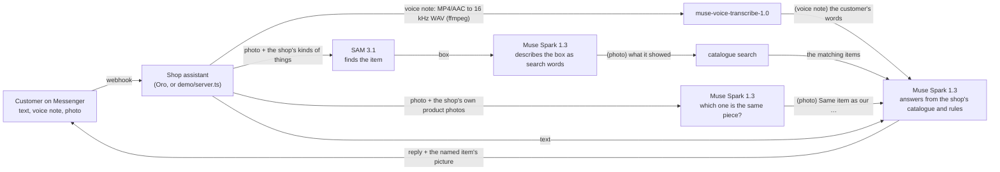

# Oro on Muse

A Messenger shop assistant that answers customers with Meta's Muse models: it reads the shop's
catalogue and rules, hears voice notes, and finds the product in a customer's photo.
Built for the Meta Global AI Developer Hackathon (Startup track), October 2026.

This repository holds the hackathon work only. It carries no code from the Oro product; Oro
reaches these models through the same client files (copied from `packages/muse-provider`).

## What is new (built during the hackathon)

| | Before | Now |
|---|---|---|
| The assistant's model | Claude Haiku 5.5 | **Muse Spark 1.3** (Meta Model API). In Oro it is "Oro Muse", a reply tier an owner picks in the agent's Model box |
| A customer's voice note | dropped: the assistant never heard it | **transcribed by `muse-voice-transcribe-1.0`** and answered, marked "(voice note)" in the record |
| "Do you have this?" with a photo | the model sees the photo | **SAM 3.1 finds the object** (the shop's own kinds of things are the phrases), Muse Spark describes it as search words, **and Muse Spark puts the photo beside the shop's own product photos** (up to 40 in one call) to say which one is the same piece; the reply names it and its picture is sent; the record reads "(photo) …" |

## How it works



A voice note and a photo become words before the assistant answers, so the conversation record and the model read the same sentence, marked "(voice note)" or "(photo)". A photo is also put beside the shop's own product photos, because a catalogue's words rarely say what a piece looks like: "Diamond Ring" does not tell one ring from another, a picture does. A note or photo that cannot be read leaves the turn as it was, and the failure is recorded. The turn itself is never dropped. In Oro, an owner picks "Oro Muse" for an agent in its Model box, and one switch can withdraw the tier in seconds. Agents on other tiers are untouched, and a Meta failure never leaves a customer without a reply.

## Packages

- `demo` (`@oro-muse/demo`): a Messenger shop assistant a judge can run (see **Try it**), and the same assistant at a terminal. Text, voice notes and photos answered from `demo/shop.json` (eight items; the photos are from Wikimedia Commons, credited in [`demo/CREDITS.md`](demo/CREDITS.md)). Everything Meta sits behind one `Deps` object, so the tests run without a network.
- `packages/muse-provider` (`@oro-muse/provider`): a dependency-free client for the Meta Model API and Baseten.
  - `chat()`: Muse Spark 1.3 and Muse Spark Open. Both models **always reason** before answering (with `max_tokens=200` every token went to reasoning and `content` came back null), so the client gives the answer room and sets `reasoning_effort`. Meta's `tool_choice` takes `auto` only, so `required` becomes `auto` and `none` sends no tools.
  - `transcribe()`: `POST /v1/asr/transcribe`, multipart `request` + `audio`. The endpoint takes mono 16-bit PCM WAV at 16 or 24 kHz only, so `toPcmWav()` converts anything else with ffmpeg. A 5-second note came back in 1.3 s, every word right. The conversion goes through files, never pipes, for two measured reasons. First, an MP4 whose index comes after its audio cannot be read from a pipe once it outgrows ffmpeg's buffer: a 3-minute note gave an empty WAV. Second, a WAV written to a pipe has no sizes in its header.
  - `segment()`: SAM 3.1 through `POST /v1/responses`. The answer is special-token text (`<0f>0<|box;x1=…;c=…|><|mask;…|>`), parsed by key; the box in source pixels is what a shop needs. The phrase matters: "bracelet" missed an arm bracelet that "jewelry" found.
  - `imageDataUri()`: Meta's API cannot fetch a Facebook CDN link, which is how Messenger gives a customer's photo: chat and SAM both answer 400 `media_url_not_fetchable`. The same picture's bytes are taken, so this fetches the picture and gives it as a data URI. Measured from 6 KB to 6.5 MB, chat and SAM alike.
  - `pictureMatch()`: the customer's photo and the shop's product photos in ONE call to Muse Spark, each after its number; it answers which numbers show the same piece and which only look alike. More than 40 product photos go in calls of 40, side by side. Measured 2026-11-03: one customer photo and 40 product photos in one call took 7.5 s and found every copy of the right item from a cropped, turned photo; on a jewellery shop's 36 product photos it named a forwarded ring, a forwarded pendant and a cropped, turned hand chain, and matched nothing for a pearl rope the shop does not sell (5 to 12 s a call, about 11k prompt tokens with 512-pixel photos).
  - `photoMatch()`: SAM first, with the shop's phrases in turn (the largest box of the first phrase that finds something wins), then Muse Spark is asked to describe what is inside that box as one JSON object: category, colours, materials, features, style, keywords, summary. No cropping library: the box is told to the model in words. `photoFact()` is the one line a reply engine puts into the turn.
  - `generateImage()`: Muse Image. The bytes under `b64_json` are WebP.

## Bench: the same assistant, three models

The bench used the reply engine of a jewellery shop's Messenger page on Oro, with its rules and catalogue as they stood on 2026-10-27. Eight scripted customers wrote in English, Burmese and Thai, one turn each. They asked for a price by name, a category, an attribute, a budget, how to pay, a discount and an order, and one sent a greeting. Each turn was checked for the right products, the catalogue price, the owner's payment facts, no discount granted, and the customer's language.

| model | passed | median turn |
|---|---|---|
| Claude Haiku 5.5 (the shop's model before) | 24/24 | 2.6 s |
| **Muse Spark 1.3** (Meta Model API, `reasoning_effort: low`) | **24/24** | 3.7 s |
| Muse Spark Open 1026 (Baseten, thinking off) | 3/24 | 6.4 s |

Muse Spark Open kept calling the catalogue tool and never wrote the reply in 21 of 24 turns. With its reasoning on, it failed 7 of 8. So the demo runs on Muse Spark 1.3. Of Muse Spark's 20k output tokens, 12k were reasoning. [`bench/README.md`](bench/README.md) has the per-language counts and token use. The transcripts are not published, because they carry the shop's own data.

## Meta tools used

- `muse-spark-1.3` (Meta Model API) and `meta-models/muse-spark-open-1026` (Baseten): the assistant's answers, with tool calling. Muse Spark 1.3 also describes the item SAM found and compares a customer's photo with the shop's own product photos.
- `muse-voice-transcribe-1.0`: customers' voice notes (25 languages; no Burmese, so the voice demo is in English and Thai).
- `sam-3.1`: finding the product in a customer's photo.
- `muse-image-1.0`: `generateImage()` in the client, checked live. The assistant does not use it: a generated picture of a product must not pass for the shop's real item.

## Try it

At a terminal, no Messenger needed (ffmpeg on PATH if you give it an MP4/M4A voice note; a 16 kHz mono WAV needs nothing):

```bash
npm install
META_MODEL_API_KEY=… npm run talk
you> How much is the locket, and can you deliver to Sukhumvit tomorrow?
shop> The Oval Silver Locket is 95 USD. Yes, we can deliver to Sukhumvit tomorrow by courier for 3 USD.   (1332 ms)
you> voice customer.wav
  heard: Hi. Do you still have the ruby hand chain? How much is it? And can you deliver to Sukhumvit tomorrow
shop> We don't have the ruby hand chain, sorry! The nearest is our Ruby Dome Ring for 320 USD. …   (3735 ms)
you> photo https://…/gold_ring_with_large_ruby.jpg
  shown: Thin gold solitaire ring with a round bezel-set red gemstone. (found as "ring"). Search words: bezel, solitaire, red, gemstone, …
  matches: Solitaire Diamond Ring; Ruby Dome Ring; Sapphire Halo Ring
shop> Yes, we have it! That's our Ruby Dome Ring for 320 USD.
  [sends picture: Ruby Dome Ring]   (5387 ms)
you> มีแหวนทับทิมไหมคะ ราคาเท่าไหร่
shop> มีค่ะ Ruby Dome Ring ราคา 320 USD ค่ะ เป็นแหวนทอง 18K ประดับทับทิมเม็ดใหญ่ค่ะ   (1394 ms)
```

(Measured 2026-10-27 on the Meta Model API, before the photo was also compared with the shop's own photos; the picture sent is of the item the reply names, not merely the best-scored match.)

As a Messenger bot: a Facebook Page, a Meta app with Messenger added, and a public URL for the webhook (ngrok or cloudflared).

```bash
PAGE_ACCESS_TOKEN=… VERIFY_TOKEN=any-word META_MODEL_API_KEY=… APP_SECRET=… npm run demo   # :3000
# Meta app → Messenger → Webhooks: callback https://<your-host>/webhook, verify token = VERIFY_TOKEN, field `messages`;
# subscribe the Page. Then message the Page: text, a voice note, or a photo.
```

`APP_SECRET` is the Meta app's secret, and it is required: every POST must carry Meta's `X-Hub-Signature-256`, and an attachment is fetched only from Meta's own hosts, so a forged event cannot make the demo fetch an arbitrary address. The webhook answers 200 at once and sends the replies after, as Messenger wants. Nothing is stored: the last few turns of each customer live in memory.

## Run the checks

```bash
npm test                     # 51 unit tests, no network
npm run typecheck
META_MODEL_API_KEY=… BASETEN_API_KEY=… npx tsx scripts/live-check.ts path/to/16k-mono.wav   # the real endpoints, test data only
```

## Privacy

While the Meta key runs on free credits, Meta may use the content for product improvement. The demo sends only its own test data. In Oro, an owner chooses Oro Muse for an agent; as of 2026-11-03, the only page it has answered is our demo page, messaged from test accounts.

## Licence

MIT.
